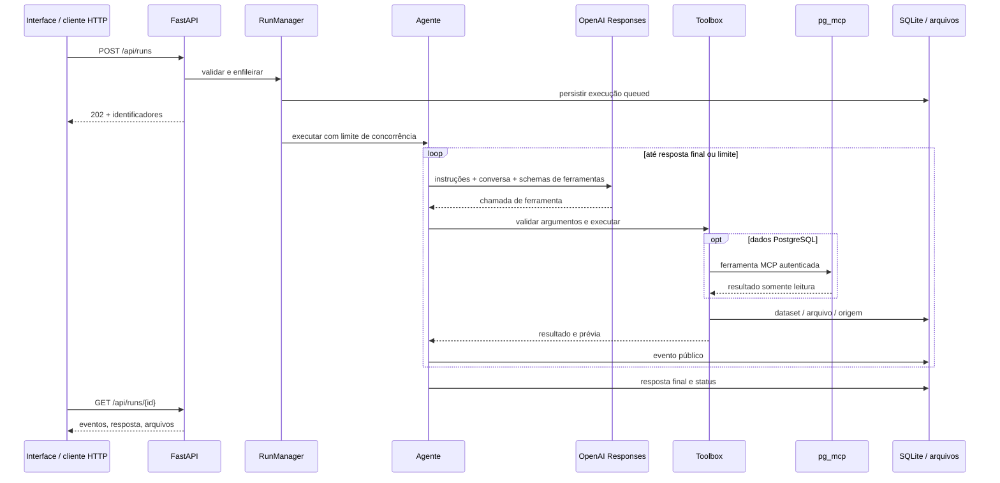

# Arquitetura

## Agendamento e subagentes

`core/workspace_models.py` define schemas Pydantic para criar perfis, delegar tarefas
individuais/em lote, cancelar auxiliares e agendar uma execução única. As capacidades
do agente são registradas em `SCHEMAS` e executadas por `SubagentControl`, sem shell
ou código arbitrário. `api/workspaces.py` fornece as rotas autenticadas dos diálogos.
Uma reserva em `workspaces` permite configurar uma sessão antes do primeiro pedido.

Os atalhos ficam no composer, ao lado de Anexar. `repositories/task_context.py` captura
contexto a partir de um run acessível, nunca de um snapshot fornecido pelo navegador.
`Run.execution_options` registra fontes selecionadas, favoritas, web e saída;
`Run.context_snapshot` guarda pedido, trechos delimitados, referências e critérios da
origem. A captura não inclui turnos posteriores à origem e comunica recortes/ausências.
O contexto é entregue como dados não confiáveis ao agente de destino, com orientação
para atualizar consultas e distinguir amostras de totais. Snapshots de agendamento
são persistidos na confirmação; referências temporárias continuam recusadas.

`propose_schedule` retorna uma proposta estruturada nos eventos, sem inserir agendamento.
O frontend renderiza a sugestão com DOM/textContent e abre revisão vinculada ao run de
origem. `schedule_task` continua disponível para autorização explícita do usuário.

Perfis têm `created_by=principal|user`, definido no servidor. A ferramenta do principal
cria apenas auxiliares controlados; o formulário cria perfis do usuário com um
`independent_conversation_id`. A API executa estes últimos em conversa própria e
reaplica seu perfil em novas mensagens. `Run.agent_profile_id` e
`origin_conversation_id` preservam a associação. O principal não pode delegar a esses
perfis. O limite atômico de dois slots inclui os dois tipos. Perfis legados sem origem
mantêm comportamento de auxiliares; não há inferência retroativa de autoria.

`repositories/workspaces.py` armazena metadados privados em `workspaces`, `subagents` e
`scheduled_tasks`. `subagent_slots` reserva apenas IDs e vagas, sem textos temporários.
A criação de perfis usa `BEGIN IMMEDIATE` e slots únicos por usuário/
conversa; no máximo dois perfis, mesmo sob concorrência. O escopo vem de `history_owner`,
nunca do payload HTTP. `TemporaryStore.workspace_subagents` guarda definições/resultados
temporários e sobrepõe perfis persistentes sem copiar conteúdos importados ao SQLite.
As vagas temporárias compartilham o limite dos perfis persistentes e são liberadas ao
encerrar a importação; reservas órfãs são removidas no startup após a limpeza temporária.

`agents/subagents.py` controla tasks assíncronas na execução do principal. Os auxiliares
compartilham `StepBudget`, com reserva da síntese final; cada auxiliar tem até 12 rodadas.
Eles não recebem ferramentas de controle e a Toolbox rejeita chamadas forjadas. A
delegação em lote usa gather e mantém o orçamento compartilhado. O cancelamento do
principal se propaga; o cancelamento individual retorna esse estado ao principal, que
pode continuar. Arquivos dos auxiliares são incorporados à lista de arquivos do principal.
`Run.parent_run_id` distingue execuções auxiliares; elas não aparecem como novas sessões
nem entram no contexto histórico ou na contagem de pedidos do usuário.
Conversas próprias de agentes do usuário não têm parent_run_id e têm orçamento
independente. Em Sessões, `repositories/session_views.py` agrupa suas conversas e os
auxiliares sob a sessão de origem, via `/api/workspace-sessions`. O agrupamento é uma
projeção de apresentação e não altera os IDs, a persistência ou os orçamentos. O frontend
exibe o título da sessão com o nome do subagente e as cores teal/violet em listas, popup
e cabeçalho. A captura de contexto não mistura seus históricos; recebe
somente a referência explicitamente selecionada. Cancelamento do principal só se propaga
aos auxiliares controlados, não às conversas pessoais.

`agents/scheduler.py` inicia no lifespan, consulta vencimentos em UTC a cada cinco
segundos e despacha pela fila do RunManager. A reivindicação de tarefas é atômica e o
run_id é reservado antes do disparo. Estados dispatching/running são reconciliados no
startup com a execução existente, após Store.recover, evitando reenvio automático de
execuções interrompidas. O worker restabelece os ContextVars de proprietário e perfil
de dashboard antes de criar o run, sem depender de cookie/JWT ainda ativo no navegador.
Não mantém credenciais do usuário; utiliza o cliente e as permissões de serviço já existentes.
Somente fontes persistentes são permitidas em agendamentos. A fila e as importações
continuam locais ao processo: a implantação suportada permanece de um único worker.

`frontend/workspaces.js` implementa os dois diálogos e atualiza estados a cada quatro
segundos enquanto abertos. Os formulários só submetem após ação explícita; o texto é
renderizado por DOM/textContent e resultados auxiliares usam o Markdown seguro existente.

## Sessões e ícones da interface

`frontend/chat-drag.js` compartilha drag-and-drop entre os cards de importações, skills
e favoritas, usando as mesmas funções de inclusão dos botões. O MIME específico carrega
somente uma chave/token para um callback registrado na página, sem SQL, linhas ou código.
Referências desconhecidas/antigas são recusadas; importações validam a sessão atual.
O comportamento de tabelas em `catalog.js` permanece compatível e o editor aceita
ambos os tipos. Nenhum drop executa consulta ou envia mensagem. Botões continuam
disponíveis para teclado e telas sem arraste.

O handler de teclado usa `setRangeText` para Alt+Enter e dispara `input` após inserir
a quebra. Isso atualiza o autocomplete e evita depender do Enter modificado nativo.

`Run.title` é um metadado opcional (até 80 caracteres) no JSON já persistido, compatível
com registros antigos. `set_conversation_title` tem schema Pydantic e registro explícito
na Toolbox, atualiza somente a execução atual e respeita o proprietário do armazenamento.
O prompt pede inferência do assunto sem dados sensíveis, junto das outras ferramentas.
`RunManager.submit` herda o título da última execução acessível daquela conversa.
Cabeçalho, sidebar e listagem renderizam o título por textContent; sem título, o cabeçalho
é **Nova Conversa**. Alterações entram na assinatura de atualização da lista. Não há
inferência local por recorte do pedido nem chamada extra de IA fora do orçamento do agente.

O rótulo de navegação é **Sessões**, com rota `/sessoes` e alias legado `/historico`.
IDs DOM e endpoints de conversas permanecem compatíveis. Os estados reais do run
determinam as classes das badges na barra lateral, na listagem e no chat. Animações
CSS só indicam atividade, sem inferir percentual de progresso. Movimento reduzido
desativa animações inclusive em pseudoelementos. O status do chat anuncia mudanças
de texto via `aria-live`, evitando repetir a mesma mensagem em cada polling.

`scheduleSessionsRefresh` mantém um único timer de quatro segundos enquanto há
sessões ativas. Abas ocultas não fazem requisições automáticas. Uma assinatura de
IDs, textos, datas e estados evita reconstruir os cards quando os dados não mudaram.
A renderização continua por DOM/textContent e usa o histórico privado retornado pela API.

A iconografia usa [Lucide](https://lucide.dev/guide/installation), versão fixada 0.468.0,
com 27 SVGs oficiais reunidos em `frontend/vendor/lucide/sprite.svg`. O helper
`historyIcon` atende também aos ícones dinâmicos de anexos, consultas e relatórios.
Indicadores de estado usam máscaras dos SVGs originais. Arquivos locais respeitam
a CSP existente; não executam scripts, não usam CDN nem exigem build Node.
`manifest.json` e `LICENSE` preservam proveniência, versão, hashes e atribuições.

## Histórico privado por usuário

`core/history_identity.py` mantém `history_owner` em ContextVar. O middleware deriva um
SHA-256 do emissor e e-mail autenticado normalizado (claim validada pelo SSO), nunca de
campos do pedido. No modo sem login, deriva do cookie opaco de perfil do navegador.
Contextos são restaurados ao fim da requisição e herdados pelas tasks do RunManager.

O repositório filtra runs, conversas, datasets, artefatos e estatísticas antes de retornar
dados ou montar o contexto da IA. O proprietário é armazenado em colunas `owner_id`
indexadas, adicionadas sem reescrever payloads ou atribuir registros legados. Regravar
um run preserva seu dono. `recover` opera no escopo interno sem usuário, preservando a
propriedade. Esse escopo interno não é exposto por parâmetros HTTP.

`ImportSession.owner_id` vincula sessões temporárias à mesma identidade; leitura, rotação
e remoção verificam o proprietário. GET/cancelamento/continuação de histórico alheio
retornam 404; cabeçalho de sessão de outro dono retorna 410. Favoritas e o catálogo de
banco mantêm o compartilhamento existente. Dashboards mantêm o perfil de navegador;
seu refresh passa pelo armazenamento privado para obter datasets.

## Plugin de internet pública

`tools/internet.py` define os schemas Pydantic `SearchWeb` e `ReadWebPage`, registrados
explicitamente em `SCHEMAS` e executados pela `Toolbox` como `search_web` e `read_web_page`.
`definitions(internet_enabled=...)` controla a exposição ao modelo; a integração também
aplica o bloqueio quando desabilitada. O launcher continua sendo `app.py`.

`RunRequest.web_search_enabled` é opt-in (padrão false). O botão **Pesquisar na web**, com `aria-pressed`,
fica no canto inferior esquerdo do composer e envia essa escolha em cada POST `/api/runs`.
A disponibilidade efetiva combina a escolha do pedido com `Settings.internet_enabled`;
o catálogo e `Toolbox.call` aplicam a mesma decisão. `/api/status` expõe `internet_enabled`
para desabilitar o controle quando indisponível na instalação. Buscas com erro não são
repetidas na mesma execução. Mais de oito chamadas numa etapa não encerram o run:
as oito primeiras são executadas; as demais recebem `function_call_output` com
`executed=false`, permitindo reavaliação na próxima etapa dentro do orçamento existente.

`integrations/internet.py` implementa HTTP assíncrono com httpx, TLS independente do MCP,
timeout total, corpo limitado e redirecionamentos manuais. Resolve DNS e rejeita qualquer
IP não público; a requisição conecta ao IP validado com Host e `sni_hostname` originais
para impedir nova resolução entre validação e conexão. Esse mecanismo segue a
[extensão SNI do HTTPX](https://www.python-httpx.org/advanced/extensions/#sni_hostname).
Cookies são descartados entre requisições e proxies de ambiente não são usados.
HTMLParser extrai texto sem scripts/estilos e interpreta os links da alternativa DuckDuckGo HTML.
O padrão `INTERNET_SEARCH_PROVIDER=openai` usa `integrations/web_search.py` com o cliente
existente: força `web_search`, `store=False`, consulta isolada e fontes/citações estruturadas.
Recusa respostas sem busca concluída ou URLs. O modelo pode ser definido em
`INTERNET_SEARCH_MODEL` (vazio reutiliza `OPENAI_MODEL`). Uma falha remove `search_web` do
catálogo pelo restante da execução; não há fallback automático. Contrato conforme a
[documentação oficial OpenAI](https://developers.openai.com/api/docs/guides/tools-web-search).

O resultado JSON preserva URL final, data de consulta, título, recortes e limites; a
pesquisa preserva também provedor, termos e URL da busca. Os eventos existentes armazenam
essa evidência, sem criar datasets de negócio automaticamente. O prompt orienta confirmação
e citação das fontes e impede tratar conteúdo remoto como instruções. A proibição de enviar
dados internos em consultas é uma orientação ao modelo, sem classificação DLP automática.
Não há execução de JavaScript, navegação autenticada ou leitura de formatos binários.
Os testes em `tests/test_internet.py` simulam DNS/HTTP e verificam registro, limites,
paginação, erro sanitizado, parsing e bloqueios de destinos e redirecionamentos.

A barra lateral mostra as duas sessões de origem mais recentes, com todos os seus
subagentes, usando `/api/workspace-sessions?limit=2`. “Ver todas as sessões” fica no
cabeçalho de Sessões, no lugar do ícone de atualização, e navega para `/sessoes`.
A biblioteca completa mantém busca, filtros e paginação. A navegação interna usa
History API, preservando a sessão temporária. Cada conversa abre sua execução mais
recente. `GET /api/conversations` mantém seu contrato sem o limite legado de 100
execuções. Dados temporários aparecem somente na sessão correspondente.

O painel “Escolher seus dados” consulta `/api/catalog/*` diretamente, sem consumir IA ou criar conversas. Cada chamada redescobre databases e aplica `ALLOWED_DATABASES`. O seletor lista somente databases em que o usuario MCP possui permissao `USAGE` no schema `public`, verificada por `pg_catalog.has_schema_privilege`; databases indisponiveis ou sem permissao sao omitidos. Listagem de tabelas e previas tambem verificam esse acesso. A ferramenta declarativa `preview_table`, com schema Pydantic e registro explícito, confirma a tabela pelo catálogo, delimita identificadores e executa somente SELECT com LIMIT de até 10 linhas (respeitando limites menores configurados). O dataset preserva database, schema, tabela, SQL, horário e `sample_only=true`; a quantidade retornada não é a contagem total da tabela. Chamadas do catálogo têm timeout de 35 segundos. Arrastar ou adicionar ao chat insere a referência completa da tabela no pedido, sem enviar automaticamente nem anexar a amostra como se fosse a base completa.

## Fluxo de uma execução

A aplicação disponibiliza ao usuário somente as bases `synap`, `deskflow`, `cora`, `crm_cob`, `hub` e `starcoop`, nessa ordem, mantendo a interseção com as bases descobertas no MCP e com `ALLOWED_DATABASES`. A restrição vale no seletor, nas ferramentas do chat e no diagnóstico de conexão. Bases externas à lista são recusadas antes de listar tabelas, descrever estruturas ou consultar dados. O seletor também verifica o acesso ao schema `public`. `ALLOWED_DATABASES` pode reduzir essa lista, mas não ampliá-la.



Há um orquestrador com ferramentas especializadas, em vez de vários agentes que trocam mensagens sem controle. Isso simplifica limites de custo, rastreabilidade e contratos. A autonomia está no ciclo de selecionar ferramentas, executar, observar resultados, corrigir erros recuperáveis e elaborar a resposta.

O orçamento padrão e máximo é de 60 rodadas de IA, configurável para menos via `MAX_AGENT_STEPS`. A última rodada não oferece ferramentas: solicita uma síntese das evidências disponíveis e das pendências, com aviso explícito na resposta. Ela conta dentro do limite, sem rodada extra. Uma resposta parcial pode encerrar a execução como `completed`, indicando que o processamento terminou, não que todas as análises foram concluídas. O timeout global continua valendo e pode interromper antes da síntese. Datasets e arquivos persistidos são preservados mesmo em falhas.

## Responsabilidades

- `integrations/temporary_imports.py`: leitura limitada de CSV/XLSX/XLS em memória, amostra para IA via função declarativa `ImportSchema`, validação da estrutura e conversão conservadora no conjunto inteiro. Sem código gerado pelo modelo. IDs com zeros à esquerda e números longos são preservados como texto; valores incompatíveis não são descartados. XLS usa xlrd e XLSX usa openpyxl com cache de fórmulas.

A importação temporária usa configurações próprias para upload, descompactação, caracteres e linhas. `office_archive` recebe um teto de expansão explícito para esse fluxo (2 GiB por padrão); os consumidores legados mantêm seu teto padrão de 50 MiB. A inspeção das declarações XML proibidas ocorre por streaming de 64 KiB, cobrindo declarações entre blocos, sem carregar e copiar cada XML inteiro nem construir uma árvore adicional. A leitura continua sem executar fórmulas, macros ou links externos. Erros de conteúdo identificam o limite efetivo; o log de recusa e o header `X-Import-Stage` registram a fase sem payload.
- `core/import_sessions.py` e `repositories/temporary_store.py`: sessões com UUID e metadados em memória, datasets Parquet em `<DATA_DIR.parent>/temp/import-sessions/<UUID>`, artefatos em subpasta da sessão e nenhum payload temporário no SQLite. Dados persistentes continuam acessíveis pelos contratos existentes. O manager temporário é selecionado quando há datasets importados na sessão ou quando o pedido dá sequência a uma conversa temporária, mesmo sem reanexar arquivos. Todas as escritas desse manager, inclusive eventos, transformações e relatórios, ficam temporárias. A ferramenta declarativa `list_imported_datasets` permite reutilizar importações durante a sessão, sem novo upload.

Uma nova conversa ou recarga da página substitui a sessão anterior da aba, cancela suas execuções temporárias e remove seus arquivos. O navegador armazena em `sessionStorage` somente o UUID, nunca células ou arquivos. Ao sair, envia também um pedido de encerramento com `keepalive`; esse sinal não é garantido em fechamento abrupto. Há limpeza a cada minuto para sessões sem atividade por uma hora (sem tarefas/importação ativa), limpeza no shutdown e remoção dos diretórios UUID órfãos no startup. A remoção recursiva valida o caminho resolvido dentro da área temporária gerenciada; não apaga arquivos arbitrários da pasta `temp` nem outras sessões. Uma importação que termina após a substituição de sua sessão é recusada e não recria arquivos. O serviço deve continuar com um único processo Uvicorn, pois os registros de sessão são locais ao processo.

O painel Importar mantém os cards dos datasets importados durante a sessão, mesmo depois de
enviar pedidos ou fechar o painel. Nova conversa limpa os cards e a contagem. O botão
Importar novos dados abre um `dialog` nativo com seleção de arquivos e progresso. O popup
fecha em sucesso integral; em falha parcial permanece aberto, mantendo os datasets válidos.
Durante o upload, fechar, cancelar e Escape ficam bloqueados. Os contratos de importação e
isolamento de sessão permanecem nos endpoints existentes.

- `app.py`: argumentos de inicialização e Uvicorn.
- `api/main.py`: HTTP, autenticação, upload, downloads, status e ciclo de vida.
- `agents/orchestrator.py`: instruções, contexto, chamadas à Responses API, gerenciamento de tarefas e transições de estado.
- `tools/data_tools.py`: schemas Pydantic, registro explícito, SQL permitido, documentação, pandas, relatórios e exportações.
- `tools/pdf_reports.py`: contrato estruturado de relatórios PDF, paginação ReportLab e gráficos vetoriais.
- `integrations/pg_mcp.py`: inicialização de sessão MCP, descoberta de ferramentas e chamadas autenticadas.
- `integrations/file_imports.py`: extração limitada de CSV/XLSX/PDF/DOCX/PPTX em datasets, sem executar fórmulas, macros, código ou referências externas. Processamento do upload em thread, com validação completa antes da persistência; um dataset por arquivo mantém o contrato `dataset_ids` e a origem. XLSX usa openpyxl, PDF usa pypdf e DOCX/PPTX usam XML dos pacotes Office. Texto é paginado pelas ferramentas existentes, sem acrescentar execução arbitrária ao agente.
- `repositories/local_store.py`: datasets, execuções, eventos e artefatos.
- `core/`: configuração, contratos públicos e erros seguros.
- `frontend/`: interface independente de frameworks e servida na mesma origem da API. `markdown.js` renderiza um subconjunto de Markdown nas respostas usando elementos DOM e nós de texto, sem interpretar HTML recebido nem carregar bibliotecas externas. Oferece títulos, negrito, itálico, texto riscado, listas aninhadas, citações, separadores, tabelas, links e código. Links aceitam HTTP(S), mailto, caminhos locais iniciados por uma barra e âncoras; imagens e HTML permanecem texto. O polling só reconstrói a resposta quando seu conteúdo muda.

## Estados e ciclo de vida

```text
queued -> running -> completed
                 -> failed
queued / running -> cancelled
```

A API retorna antes de a IA terminar. O `RunManager` mantém `asyncio.Task`s no processo, com semáforo para concorrência e limite de fila. Uma conversa não aceita duas execuções simultâneas. O limite de tempo começa após adquirir o semáforo; o tempo em fila não entra nessa conta.

Cancelamento interrompe a tarefa local e novas chamadas. Uma consulta que já chegou ao servidor MCP ou uma chamada ao provedor pode continuar até seu próprio timeout; custos já incorridos e arquivos concluídos são preservados. Ao reiniciar, execuções pendentes são marcadas como interrompidas. Elas não são retomadas automaticamente.

O cliente da IA e a leitura de respostas do MCP toleram até 150 segundos de espera. Esse timeout de transporte não substitui o orçamento global de execução nem altera limites impostos pelo servidor PostgreSQL/MCP.

Use **um processo Uvicorn**. O armazenamento é persistente, mas a fila é local ao processo. Múltiplos workers exigem uma fila compartilhada e coordenação de recuperação. Para crescer: mova o gerenciamento para um worker com fila durável e o armazenamento para PostgreSQL/object storage; mantenha os contratos HTTP.

## Memória e dados

O SQLite guarda três tabelas: `runs`, `datasets` e `artifacts`. Os registros usam UUIDs e JSON. Cada operação abre e fecha sua própria conexão; WAL e timeout reduzem conflitos locais.

Um dataset contém linhas e metadados de origem. Queries registram database, SQL normalizado, limite, data e possibilidade de truncamento. Transformações geram outro dataset com referência ao original e operações realizadas. O agente recebe prévias; exportações usam as linhas persistidas.

Prévias e estatísticas retornam `possibly_truncated`, `scope: stored_rows_only` e `warnings`. A possibilidade de truncamento é herdada de toda a cadeia de transformações, inclusive ao agregar uma amostra em uma única linha. Relatórios Markdown/HTML incluem automaticamente essa limitação. Ausência de truncamento não prova que as linhas representam toda a população de negócio: filtros e SQL continuam definindo o universo consultado. A paginação informa `offset` e `next_offset`; `preview_only` também considera linhas anteriores à página atual.

A conversa recupera até seis registros recentes, incluindo respostas e resumos dos resultados de ferramentas. Não é uma memória sem limite: o agente deve reinspecionar datasets quando necessário. `store=False` desativa a persistência de Responses pela API; isso não substitui as políticas de tratamento de dados do provedor. Conteúdos enviados ao modelo incluem o pedido, trechos de documentos, prévias e resultados das ferramentas.

## Documentação de negócio

Adicione regras, dicionários de dados e exemplos de consultas em `docs/`. A busca é textual, sem embeddings ou serviço adicional. São indexados até 300 arquivos de até 1 MiB; uma busca retorna até oito trechos. A leitura é paginada em blocos de 12.000 caracteres.

Os documentos devem explicar conceitos como data de competência, filtros de situação, critérios de agrupamento e cálculo de indicadores. Regras em português ajudam o agente a ligar a pergunta às colunas corretas. Documentos nunca devem conter senhas, chaves ou dados pessoais desnecessários.

O catálogo é restrito às raízes configuradas. Caminhos arbitrários e arquivos ocultos não são ferramentas de leitura. Resultados e documentos são tratados como dados não confiáveis nas instruções do agente.

## Ferramentas

| Ferramenta | Papel |
| --- | --- |
| `update_plan` | Registra o plano público de ações |
| `search_docs`, `read_doc` | Recuperam documentação local |
| `list_databases` | Descobre bancos e aplica a lista fixa de seis bases e `ALLOWED_DATABASES` |
| `list_tables`, `describe_table` | Inspecionam o schema real |
| `query` | Valida um SELECT e materializa dataset limitado |
| `inspect_dataset` | Mostra schema, origem e página de linhas |
| `analyze_dataset` | Calcula estatísticas e qualidade de dados |
| `transform_dataset` | Seleciona, filtra, ordena, limpa, converte números explicitamente e agrega |
| `export_dataset` | Gera CSV, XLSX ou JSON |
| `create_report` | Gera Markdown/HTML, tabelas e gráfico opcional |
| `create_pdf_report` | Gera PDF profissional A4 com seções, gráficos vetoriais e origem resumida |

Os schemas são disponibilizados como function tools da Responses API. O modelo pode pedir até oito chamadas independentes na mesma rodada (`parallel_tool_calls=True`), reduzindo idas ao provedor. A execução local continua sequencial, com validação Pydantic e limites de acesso; chamadas dependentes devem aguardar os resultados da rodada anterior. O prompt orienta reutilizar schemas/resultados, reunir indicadores em SQL e evitar consultas apenas para formatar números. Isso reduz rodadas potenciais, mas não garante que todo modelo agrupe chamadas. Erros de argumentos ou operação voltam ao modelo para possível correção; falhas de infraestrutura encerram a execução com mensagem controlada quando não houver recuperação.

A interface acrescenta apenas eventos novos durante o polling, preservando detalhes abertos. O evento atual permanece destacado; o anterior e os mais antigos esmaecem progressivamente. Hover, foco, detalhes abertos e erros recuperam a opacidade completa. O painel tem rolagem limitada e acompanha os novos eventos somente quando o operador já está próximo do fim. A preferência por movimento reduzido desativa as transições.

Erros de validação identificam os campos e tipos de erro sem repetir valores recebidos. Operações exigem seus parâmetros essenciais antes de acessar dados. Colunas inexistentes e agregações numéricas sobre texto produzem orientações para correção. `sum`, `mean` e `median` exigem dtype numérico, evitando concatenação de valores textuais.

`analyze_dataset` informa `numeric_text_columns` como candidatos à conversão, sem alterar dados nem presumir que códigos sejam medidas. `transform_dataset` aceita `{"op":"to_numeric","columns":["valor"]}`: usa ponto decimal, preserva nulos e rejeita textos incompatíveis ou valores infinitos. Falhas não materializam um dataset parcial. Separadores locais devem ser tratados na origem ou em SQL explícito; identificadores com zeros à esquerda devem permanecer como texto.

## Adicionar uma ferramenta

As ferramentas declarativas `create_excel_report`, `forecast_series` e `find_patterns` têm schemas Pydantic e registro explícito na Toolbox. A primeira monta um XLSX com resumo e abas escolhidas, neutraliza textos que poderiam virar fórmulas e preserva medidas numéricas; não publica a proveniência técnica no relatório. `forecast_series` usa statsmodels/arch sobre datasets existentes, com limites de tamanho, frequência regular, ADF, Johansen para VECM, verificação de convergência para volatilidade, intervalo condicional e backtest sem usar o holdout na seleção de rank/diagnóstico de treino. Ordens são explícitas. A validação é de uma única janela, não validação robusta de generalização. Os cálculos rodam em thread para não bloquear o loop HTTP; o ajuste continua limitado pelo tamanho e iterações. Não executam código do usuário nem acessam banco diretamente. A projeção é armazenada como novo dataset com histórico original, parâmetros, diagnósticos, backtest e `forecast_only=true`; `analysis_warnings` acompanha transformações e relatórios via `coverage`. `find_patterns` retorna evidências exploratórias, quantidade de pares e ressalvas, sem alterar dados nem atribuir causas.

O catálogo `core/skill_catalog.py` descobre skills em `skills/*/SKILL.md` e inclui o guia existente `skills/pg_mcp/pg_mcp_docs.md`. A API autenticada `/api/skills` lista nome, descrição e caminho lógico legível por `read_doc`, sem executar arquivos. `Toolbox.documents` usa o mesmo catálogo para disponibilizar as novas skills. Pastas ocultas e arquivos fora da raiz não são publicados. No lado direito do container do chat, “Escolher seus dados” e “Escolher suas skills” abrem painéis exclusivos; escolher uma skill insere sua referência no pedido, sem envio automático.

Os relatórios PDF, HTML e Markdown aceitam `tables`: até seis tabelas analíticas, cada uma com `dataset_id` interno, `title`, `context`, até seis `columns` (`key`, `label`, `unit`) e `max_rows` de 1 a 30 (padrão 12). Somente os campos escolhidos são renderizados; cabeçalhos usam rótulos de negócio. Dataset ou coluna inválidos impedem a criação do artefato. O recorte de linhas é informado e não representa total da base. Gráficos PDF aceitam `context`; o gráfico HTML aceita `chart_title`, `chart_context` e `chart_unit`. O Markdown inclui tabelas analíticas; gráficos incorporados são oferecidos em PDF/HTML.

A skill `skills/pdf-report/SKILL.md` fica disponível em `search_docs` e `read_doc` como `pdf_report/SKILL.md`. O prompt orienta sua leitura ao preparar PDFs. Ela define narrativa, escolha de gráficos e limites; a execução ocorre pela ferramenta registrada `create_pdf_report`, sem execução arbitrária de scripts. O schema exige título, período, resumo, metodologia e datasets reais; gráficos referenciam um desses datasets. O gerador não acessa rede ou arquivos de entrada livres. ReportLab incorpora fontes Vera e desenha gráficos vetoriais, mantendo acentos e nitidez. O PDF é persistido no repositório e servido como `application/pdf`.

Avisos de amostra acompanham o relatório em linguagem de negócio. Gráficos exibem até 20 pontos (12 por padrão), na ordem do dataset, sem agregação implícita; medidas nulas, não finitas ou inválidas e categorias repetidas são recusadas. PDF, Markdown e HTML apresentam dados do PostgreSQL como “Fonte: Banco de dados interno”, inclusive após transformações. Não incluem automaticamente nomes de tabelas, schemas, databases, SQL, IDs ou tabelas-fontes; a origem completa continua preservada nos datasets e eventos internos. Anexos continuam identificados como arquivos enviados. No PDF, `table_rows` tem padrão 0; um quadro de indicadores de até 30 linhas e seis colunas pode ser incluído quando explicitamente solicitado. Não há inspeção visual automática por execução; alterações do gerador devem ser verificadas com renderização de exemplos e testes de conteúdo/paginação.

1. Em `tools/data_tools.py`, crie uma classe derivada de `Arguments` com campos tipados, limites e docstring de finalidade.
2. Registre o nome e a classe em `SCHEMAS`.
3. Implemente `async def nome_da_ferramenta(self, args)` em `Toolbox`.
4. Retorne um objeto serializável em JSON. Use `AgentError` para erros que possam ser apresentados ao modelo.
5. Para dados ou arquivos, use o repositório para preservar origem e gerar identificadores reais.
6. Teste o contrato e os limites. Atualize a lista de capacidades e, se necessário, o prompt do agente.

Não adicione `eval`, `exec`, shell, SQL de escrita ou acesso livre ao sistema de arquivos como atalho para ampliar as capacidades. Se uma nova ferramenta tiver efeitos externos, defina autorização e revisão específicas para ela.

## Limites importantes

- O parser SQL é uma defesa adicional, não uma sandbox de banco. A proteção final depende do servidor MCP, de transações somente leitura e das permissões do usuário PostgreSQL. UDFs podem ter efeitos colaterais; restrinja o papel do banco.
- Totais devem ser calculados no SQL quando a base for maior que o limite retornado. `possibly_truncated` exige que a resposta declare a limitação.
- Estatísticas refletem tipos inferidos: decimais PostgreSQL serializados como texto precisam de CAST/agregação no SQL ou conversão explícita `to_numeric` no dataset limitado. O pandas pode inferir identificadores numéricos em CSV e remover zeros à esquerda; prepare essas colunas como texto quando a preservação for essencial.
- Junções e análises volumosas devem ocorrer no PostgreSQL. Transformações locais atendem datasets limitados; não há execução livre de código.
- HTML escapa o conteúdo recebido. CSV e Excel neutralizam células textuais com prefixos de fórmula. Isso pode acrescentar um apóstrofo em textos que começam por `=`, `+`, `-` ou `@`.
- HTML inclui no máximo 100 linhas por tabela e 20 barras no gráfico. Use o Excel/CSV para as linhas completas do dataset. O gráfico mostra a magnitude; o sinal aparece no rótulo.
- Há autenticação individual opcional por SSO ScdAuth. Histórico, datasets, arquivos e importações são privados por usuário. Favoritas permanecem compartilhadas; agendamentos são privados e executados pelo processo da aplicação. Não há RAG vetorial.

## Referências de implementação

- [OpenAI: function calling e ciclo de ferramentas](https://developers.openai.com/api/docs/guides/function-calling)
- [MCP Python SDK, linha v1 usada pelo projeto](https://github.com/modelcontextprotocol/python-sdk/tree/v1.x)
- [FastAPI: aplicações maiores](https://fastapi.tiangolo.com/tutorial/bigger-applications/)


### Autocomplete do chat

`frontend/mentions.js` detecta `/` e `@` no cursor, consulta os endpoints existentes de skills e catálogo e insere menções legíveis no editor. No envio, `expandChatMentions` expande somente as menções selecionadas que ainda estão presentes para as instruções e referências completas no pedido. `@` descobre somente as bases permitidas pelo seletor e consulta as tabelas de uma base escolhida no schema `public`, sem buscar linhas. O menu tem listbox, opção ativa, seleção por teclado e invalidação de respostas assíncronas antigas. Não há novos endpoints ou ferramentas, dependências Node ou acesso arbitrário a código.


O layout do chat é implementado diretamente em `frontend/index.html` e `frontend/style.css`, mantendo os IDs usados pelos módulos existentes. O CSS usa dimensões compartilhadas para a navegação e os painéis, sugestões compactas e tipografia maior. Em telas até 760 px, o histórico fica no topo e os seletores aparecem na parte inferior. O campo de mensagem mantém foco visível, suporte aos atalhos e menu de seleção acima do editor; animações respeitam a preferência de movimento reduzido.
## Consultas favoritas

O catálogo em `frontend/catalog.js` exibe a prévia de tabelas em um `dialog` nativo separado
do painel Dados, mantendo a lista e o seletor de bases no painel. O popup tem título e
descrição acessíveis, foco no fechamento, suporte a Escape e tabela com rolagem. Fechar ou
alterar a base/schema invalida respostas pendentes por `previewRevision`. O endpoint e os
limites da prévia permanecem iguais.

`Store` mantém definições em `favorite_queries` no SQLite existente, com UUID e datas de
criação/atualização. CRUD usa parâmetros SQL. A coleção é compartilhada por instalação e
os endpoints usam a autorização de `/api`. As definições não armazenam resultados.
`FavoriteQuery` valida nome, descrição, database, SQL e limite; salvar valida o SELECT
localmente sem consultar PostgreSQL. `list_favorite_queries` e `run_favorite_query` têm
schemas Pydantic e registro explícito em `SCHEMAS`.

`run_favorite_query` lê a definição persistente, descobre as bases permitidas, revalida o
SQL e reutiliza `_query`. A origem registra SQL efetivamente executado, base, limites,
truncamento, ID/nome da favorita e data da versão. Quando a execução pertence a uma sessão,
o dataset usa `TemporaryStore`; as definições continuam no `Store` persistente. `query_ids`
em `RunRequest` seleciona até dez definições para o contexto do agente, identificadas como
ainda não executadas. O agente também pode localizar favoritas com a ferramenta de listagem.
`frontend/queries.js` fornece CRUD, prévia e seleção de definições/datasets no chat sem build.
O painel Queries exibe a lista de favoritas. Criação e edição usam um `dialog` nativo
com título acessível, foco no nome, cancelamento por Escape e mensagens de erro no próprio
popup. As bases só são carregadas ao abrir o editor; salvar fecha o popup e atualiza a lista.
O atalho `?` em `frontend/mentions.js` usa `GET /api/queries`, filtra pelo nome sem acentos e
insere menção legível. No envio, a menção se expande para o ID salvo e a ferramenta
`run_favorite_query`, sem consultar linhas durante a seleção. Edições/exclusões locais
invalidam o cache do menu. Seleção e teclado seguem o fluxo existente de `/` e `@`.

## Perfil local e aparência

`api/auth.py` registra `/login` (GET/POST) e `/logout` em todas as configurações.
O bypass de desenvolvimento pode iniciar sessões sem ativar/configurar o emissor SSO;
nessa combinação, API e páginas exigem sessão. POST JWT sem SSO configurado retorna 503.
`integrations/sso.py` valida chave RSA, assinatura RS256, claims obrigatórias, purpose,
issuer, audience, sub/email e target fixo de configuração, com PyJWT. Somente nome,
uid, perfil, cargo, função, departamento, número/nome do PA e foto são extraídos do objeto `user`; campos desconhecidos e
sensíveis são descartados. A identidade principal vem de sub/email do JWT validado.
O handoff usa httpx, HTTPS verificado, CA própria opcional e timeout, sem herdar
exceções TLS do MCP. A entrada também limita corpo e tentativas por IP/fingerprint.

`repositories/auth_sessions.py` guarda identidade validada e expiração em SQLite
separado, com somente SHA-256 dos cookies e jtis. O consumo de jti e a criação/rotação
de sessão são atômicos. O cookie opaco é HttpOnly/Secure/SameSite=Lax; logout revoga
no servidor. A duração local é configurável e independente do JWT de entrada.
O middleware resolve a identidade em `request.state`, protege API e páginas e impede
cache. `/api/profile` usa nome/e-mail autenticados. A biblioteca de dashboards mantém
seu proprietário opaco de navegador. Histórico, datasets, arquivos e estatísticas são
filtrados pelo proprietário autenticado, inclusive nas tarefas assíncronas.
Não há consulta ao banco real ou IA no login. Com SSO desligado o contrato anterior
de API key e perfil local permanece. GET de desenvolvimento é um bypass explícito
controlado pela combinação de `ENVIRONMENT=development` e `--development` no launcher.
O launcher seleciona a factory `api.main:create_development_app`, que passa uma flag
de execução explícita a `create_app` e às rotas de autenticação, inclusive no reload.
Essa flag não é carregada de `.env`; `api.main:app` mantém o bypass desabilitado.
Em HTTP local, somente o bypass permite cookie sem Secure mesmo quando o padrão é true.
Uma identidade com uid `development` não é aceita quando o bypass está desabilitado.

A área do usuário abre um `dialog` nativo em `frontend/index.html`. `frontend/profile.js`
consulta `/api/profile` ao abrir ou atualizar, apresenta estados de carregamento/erro e
invalida respostas após fechar o popup. O perfil informa explicitamente o escopo
privado do histórico e compartilhado das favoritas; com SSO ativo, nome/e-mail vêm da identidade autenticada.
O mesmo endpoint é consultado ao iniciar a página para preencher nome/departamento na barra
lateral, sem exigir a abertura do popup. As atualizações sincronizam ambos os locais;
respostas antigas são descartadas. No bypass, a identidade das sessões existentes é
resolvida a partir dos valores `ENVIRONMENT_*` carregados no processo atual; mudanças
no arquivo de ambiente exigem reiniciar a aplicação e atualizar a página.
`Store.usage_statistics` agrega os pedidos e arquivos do usuário no SQLite; `TemporaryStore`
adiciona somente os metadados da sessão atual, agrupando conversas por ID distinto.
Os modelos Pydantic `LocalProfile` e `UsageStatistics` definem o contrato de resposta.
`LocalProfile` expõe campos profissionais permitidos e `auth_mode`, sem repassar o
objeto bruto de sessão. O painel usa iniciais, badge do perfil de acesso, origem da
sessão, cargo/função/departamento/unidade e totais privados em seções distintas.
Campos ausentes mostram “Não informado”; os valores entram por `textContent`.
O dialog tem cabeçalho e rodapé fixos, conteúdo com rolagem e colunas adaptadas ao celular.
`Atualizar perfil` relê a sessão atual, sem consultar o emissor; alterações cadastrais
no ScdAuth requerem novo login. `Sair da sessão` chama `POST /logout`, remove o identificador
de importação do sessionStorage e redireciona para `/login?logged_out=1` apenas em sucesso
ou sessão já expirada. Falhas mantêm a página e permitem tentar novamente.

`frontend/theme.js` aplica `data-theme` antes do CSS para restaurar a preferência
`scd-theme` do localStorage. `profile.js` alterna claro/escuro e sincroniza outras abas.
Sem armazenamento disponível, a troca funciona na página atual. O CSS compartilha
variáveis de superfícies, texto e estados entre chat, histórico, painéis e diálogos.

## Dashboards HTML

A skill `skills/dashboard/SKILL.md` orienta a ferramenta de criação. `DashboardFilter`
define filtros declarativos `select` e `text`. O renderizador filtra as linhas retornadas
antes de agregar widgets (`sum`, `mean`, `count`, `min`, `max`) e aplicar `max_rows`.
Opções vêm do dataset completo retornado, preservando avisos de amostra e origem.
O runtime envia seleções por `postMessage`; a página aceita apenas mensagens do
`contentWindow` do iframe atual e pede novo HTML pela API autenticada. O iframe
continua sem acesso à origem. Seleções ficam em memória na página e são reaplicadas
no refresh; uma revisão descarta respostas anteriores e agenda a seleção mais recente.
Dashboards antigos sem `filters` e sem `aggregation` preservam seu comportamento.

`tools/dashboards.py` define os schemas Pydantic `Dashboard` e `Widget`, registrados em
`SCHEMAS` como `create_dashboard`. `RunRequest.output_format` aceita `auto` e `dashboard`.
A ferramenta retorna um artefato de navegação para `/dashboards/uuid`, sem download estático.
A biblioteca fica em `/dashboards`; cada dashboard abre em página própria, com retorno à
biblioteca, URL direta e suporte ao histórico do navegador.
Widgets: cards `metric`, gráficos `bar`, `line`, `donut` e tabelas `table` interativas.
O HTML e os SVGs são renderizados por código controlado, com dados e rótulos escapados.
O agente não fornece scripts ou HTML arbitrário. O iframe usa sandbox `allow-scripts`,
sem `allow-same-origin`; o único script é `dashboard-runtime.js`, fixo e local, para
busca, ordenação e paginação. A CSP da aplicação continua sem scripts inline ou CDN.

`repositories/dashboards.py` persiste especificação e receita de atualização em SQLite,
sem copiar linhas importadas. A criação usa `BEGIN IMMEDIATE`, contando e inserindo
na mesma transação para garantir no máximo quatro por proprietário mesmo sob concorrência.
O proprietário é um token opaco de navegador em cookie HttpOnly. Um ContextVar transmite
esse perfil às tarefas assíncronas do agente. Não é uma conta individual autenticada.

O refresh repete o SQL original e reaplica transformações declarativas, revalidando bases,
SQL e limites. `RefreshStore` guarda resultados apenas em memória, sem acumular datasets.
Uma fonte compartilhada por widgets é resolvida uma vez por atualização. Dados importados
dependem do dataset ainda existir na sessão; projeções sem receita reproduzível são recusadas.
Avisos de amostra e origem continuam presentes no HTML. `frontend/dashboards.js` evita
requisições sobrepostas e descarta respostas antigas ao trocar o dashboard selecionado.
# Planejamento antes do agendamento

`agents/schedule_planner.py` faz uma chamada isolada ao modelo para devolver um plano Pydantic. A chamada não dispõe das ferramentas da aplicação e não cria runs nem tarefas. A interface mantém o pedido e as opções capturados, apresenta as etapas e exige confirmação antes de revelar o formulário de data e hora. O agendamento persistido inclui `plan_steps`, que o scheduler repassa como plano confirmado na execução futura. O seletor de delegação consulta os perfis da sessão e permite reutilização ou criação respeitando o limite existente de dois.

O planejamento e sua confirmacao ficam no chat; o dialogo configura somente a regra temporal. `core/schedule_recurrence.py` calcula a proxima ocorrencia diaria/semanal no fuso IANA. `finish_schedule` atualiza a regra e reserva um novo run UUID em transacao, verificando status e run_id atuais para nao ressuscitar cancelamentos ou duplicar conclusoes antigas. A pagina /agendamentos lista todas as regras por proprietario.
