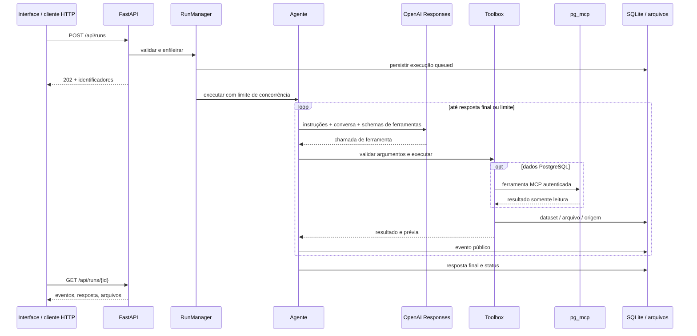

# Arquitetura

## Fluxo de uma execução



Há um orquestrador com ferramentas especializadas, em vez de vários agentes que trocam mensagens sem controle. Isso simplifica limites de custo, rastreabilidade e contratos. A autonomia está no ciclo de selecionar ferramentas, executar, observar resultados, corrigir erros recuperáveis e elaborar a resposta.

## Responsabilidades

- `app.py`: argumentos de inicialização e Uvicorn.
- `api/main.py`: HTTP, autenticação, upload, downloads, status e ciclo de vida.
- `agents/orchestrator.py`: instruções, contexto, chamadas à Responses API, gerenciamento de tarefas e transições de estado.
- `tools/data_tools.py`: schemas Pydantic, registro explícito, SQL permitido, documentação, pandas, relatórios e exportações.
- `integrations/pg_mcp.py`: inicialização de sessão MCP, descoberta de ferramentas e chamadas autenticadas.
- `repositories/local_store.py`: datasets, execuções, eventos e artefatos.
- `core/`: configuração, contratos públicos e erros seguros.
- `frontend/`: interface independente de frameworks e servida na mesma origem da API.

## Estados e ciclo de vida

```text
queued -> running -> completed
                 -> failed
queued / running -> cancelled
```

A API retorna antes de a IA terminar. O `RunManager` mantém `asyncio.Task`s no processo, com semáforo para concorrência e limite de fila. Uma conversa não aceita duas execuções simultâneas. O limite de tempo começa após adquirir o semáforo; o tempo em fila não entra nessa conta.

Cancelamento interrompe a tarefa local e novas chamadas. Uma consulta que já chegou ao servidor MCP ou uma chamada ao provedor pode continuar até seu próprio timeout; custos já incorridos e arquivos concluídos são preservados. Ao reiniciar, execuções pendentes são marcadas como interrompidas. Elas não são retomadas automaticamente.

Use **um processo Uvicorn**. O armazenamento é persistente, mas a fila é local ao processo. Múltiplos workers exigem uma fila compartilhada e coordenação de recuperação. Para crescer: mova o gerenciamento para um worker com fila durável e o armazenamento para PostgreSQL/object storage; mantenha os contratos HTTP.

## Memória e dados

O SQLite guarda três tabelas: `runs`, `datasets` e `artifacts`. Os registros usam UUIDs e JSON. Cada operação abre e fecha sua própria conexão; WAL e timeout reduzem conflitos locais.

Um dataset contém linhas e metadados de origem. Queries registram database, SQL normalizado, limite, data e possibilidade de truncamento. Transformações geram outro dataset com referência ao original e operações realizadas. O agente recebe prévias; exportações usam as linhas persistidas.

A conversa recupera até seis registros recentes, incluindo respostas e resumos dos resultados de ferramentas. Não é uma memória sem limite: o agente deve reinspecionar datasets quando necessário. `store=False` desativa a persistência de Responses pela API; isso não substitui as políticas de tratamento de dados do provedor. Conteúdos enviados ao modelo incluem o pedido, trechos de documentos, prévias e resultados das ferramentas.

## Documentação de negócio

Adicione regras, dicionários de dados e exemplos de consultas em `docs/`. A busca é textual, sem embeddings ou serviço adicional. São indexados até 300 arquivos de até 1 MiB; uma busca retorna até oito trechos. A leitura é paginada em blocos de 12.000 caracteres.

Os documentos devem explicar conceitos como data de competência, filtros de situação, critérios de agrupamento e cálculo de indicadores. Regras em português ajudam o agente a ligar a pergunta às colunas corretas. Documentos nunca devem conter senhas, chaves ou dados pessoais desnecessários.

O catálogo é restrito às raízes configuradas. Caminhos arbitrários e arquivos ocultos não são ferramentas de leitura. Resultados e documentos são tratados como dados não confiáveis nas instruções do agente.

## Ferramentas

| Ferramenta | Papel |
| --- | --- |
| `update_plan` | Registra o plano público de ações |
| `search_docs`, `read_doc` | Recuperam documentação local |
| `list_databases` | Descobre bancos e aplica `ALLOWED_DATABASES` |
| `list_tables`, `describe_table` | Inspecionam o schema real |
| `query` | Valida um SELECT e materializa dataset limitado |
| `inspect_dataset` | Mostra schema, origem e página de linhas |
| `analyze_dataset` | Calcula estatísticas e qualidade de dados |
| `transform_dataset` | Seleciona, filtra, ordena, limpa e agrega |
| `export_dataset` | Gera CSV, XLSX ou JSON |
| `create_report` | Gera Markdown/HTML, tabelas e gráfico opcional |

Os schemas são disponibilizados como function tools da Responses API. Chamadas são sequenciais e validadas novamente pelo Pydantic. Erros de argumentos ou operação voltam ao modelo para possível correção; falhas de infraestrutura encerram a execução com mensagem controlada quando não houver recuperação.

## Adicionar uma ferramenta

1. Em `tools/data_tools.py`, crie uma classe derivada de `Arguments` com campos tipados, limites e docstring de finalidade.
2. Registre o nome e a classe em `SCHEMAS`.
3. Implemente `async def nome_da_ferramenta(self, args)` em `Toolbox`.
4. Retorne um objeto serializável em JSON. Use `AgentError` para erros que possam ser apresentados ao modelo.
5. Para dados ou arquivos, use o repositório para preservar origem e gerar identificadores reais.
6. Teste o contrato e os limites. Atualize a lista de capacidades e, se necessário, o prompt do agente.

Não adicione `eval`, `exec`, shell, SQL de escrita ou acesso livre ao sistema de arquivos como atalho para ampliar as capacidades. Se uma nova ferramenta tiver efeitos externos, defina autorização e revisão específicas para ela.

## Limites importantes

- O parser SQL é uma defesa adicional, não uma sandbox de banco. A proteção final depende do servidor MCP, de transações somente leitura e das permissões do usuário PostgreSQL. UDFs podem ter efeitos colaterais; restrinja o papel do banco.
- Totais devem ser calculados no SQL quando a base for maior que o limite retornado. `possibly_truncated` exige que a resposta declare a limitação.
- Estatísticas refletem tipos inferidos: decimais PostgreSQL serializados como texto precisam de CAST ou agregação no SQL. O pandas pode inferir identificadores numéricos em CSV e remover zeros à esquerda; prepare essas colunas como texto quando a preservação for essencial.
- Junções e análises volumosas devem ocorrer no PostgreSQL. Transformações locais atendem datasets limitados; não há execução livre de código.
- HTML escapa o conteúdo recebido. CSV e Excel neutralizam células textuais com prefixos de fórmula. Isso pode acrescentar um apóstrofo em textos que começam por `=`, `+`, `-` ou `@`.
- HTML inclui no máximo 100 linhas por tabela e 20 barras no gráfico. Use o Excel/CSV para as linhas completas do dataset. O gráfico mostra a magnitude; o sinal aparece no rótulo.
- Não há autenticação individual, isolamento entre usuários, agendamento, RAG vetorial ou exportação PDF nativa nesta versão.

## Referências de implementação

- [OpenAI: function calling e ciclo de ferramentas](https://developers.openai.com/api/docs/guides/function-calling)
- [MCP Python SDK, linha v1 usada pelo projeto](https://github.com/modelcontextprotocol/python-sdk/tree/v1.x)
- [FastAPI: aplicações maiores](https://fastapi.tiangolo.com/tutorial/bigger-applications/)
